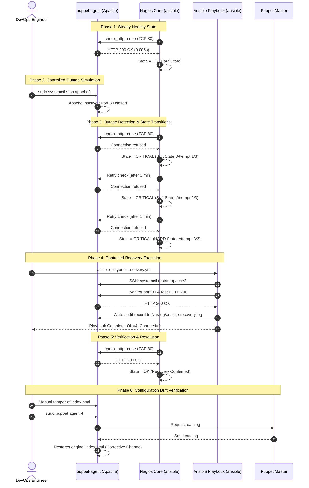

# System Architecture and Operational Workflow

## 1. Multi-Node AWS EC2 Topology

The project transitions from a local prototype to a three-tier cloud deployment hosted on Amazon Web Services (AWS) EC2 instances within a single Virtual Private Cloud (VPC). All administrative and monitoring interactions utilize private IP connectivity across the VPC.

```mermaid
flowchart TD
    subgraph AWS_VPC ["AWS VPC (Private Network 172.31.0.0/16)"]
        subgraph MasterNode ["puppet-master (EC2)"]
            PM["Puppet Server 8.x<br/>(TCP 8140)"]
            PM_M["Manifests & Modules<br/>(/etc/puppetlabs/code/...)"]
        end

        subgraph AgentNode ["puppet-agent (EC2)"]
            PA["Puppet Agent Daemon"]
            AP["Apache2 Web Server<br/>(TCP Port 80)"]
            SITE["Sample Website<br/>/var/www/html/index.html"]
            REC_LOG["Audit Log<br/>/var/log/ansible-recovery.log"]
            PA -->|Enforces State| AP
            PA -->|Enforces File| SITE
        end

        subgraph MonitoringNode ["ansible (EC2)"]
            ANS["Ansible Control Node"]
            NAG["Nagios Core 4.x Daemon"]
            WEB_UI["Nagios Web Interface<br/>(HTTP Basic Auth)"]
            PLUGINS["Nagios Plugins<br/>(check_http, check_ping)"]
            PB["Recovery Playbook<br/>(ansible/playbooks/recovery.yml)"]
            NAG --> PLUGINS
        end

        %% Communications
        PA -->|Catalog Fetch / Reports (TCP 8140)| PM
        PLUGINS -->|check_http Probe (TCP 80)| AP
        ANS -->|Controlled Recovery via SSH (TCP 22)| AgentNode
    end

    subgraph AdminWorkstation ["DevOps Engineer / Student Workstation"]
        SSH_CLIENT["SSH Terminal / Bastion"]
        BROWSER["Web Browser (Local port-forward)"]
    end

    SSH_CLIENT -.->|Restricted SSH (Port 22)| MasterNode
    SSH_CLIENT -.->|Restricted SSH (Port 22)| AgentNode
    SSH_CLIENT -.->|Restricted SSH (Port 22)| MonitoringNode
    BROWSER -.->|Local Port Forward 8080->80| NAG
```

---

## 2. Component Roles and Separation of Concerns

To avoid conflicting state management, each technology has a strictly delineated role:

| Component | Host | Responsibility | What It Manages | What It Does NOT Manage |
| :--- | :--- | :--- | :--- | :--- |
| **Puppet** | `puppet-master` & `puppet-agent` | **Declarative State Enforcement** | Installs Apache, ensures service is enabled on boot, manages static `index.html` file, remediates drift. | Does not execute ad-hoc recovery triggers or monitor network latency. |
| **Nagios Core** | `ansible` | **Continuous Health Probing & Observability** | Periodically issues HTTP GET checks against `puppet-agent:80`, tracks soft/hard failure thresholds, displays dashboard. | Does not modify server configurations or install packages. |
| **Ansible** | `ansible` | **Controlled Incident Recovery & Orchestration** | Executes push-based recovery playbooks over SSH to restart Apache safely, verify health, and write audit trails. | Does not continuously enforce background desired-state drift. |

---

## 3. Detailed Failure and Recovery Workflow

The system progresses through a defined state lifecycle when an outage occurs:



---

## 4. Network and Security Group Boundaries

| Source Host | Destination Host | Protocol / Port | Purpose | Justification |
| :--- | :--- | :--- | :--- | :--- |
| `puppet-agent` | `puppet-master` | TCP `8140` | Puppet Master communication | Agent retrieves compiled catalogs and uploads reports. |
| `ansible` | `puppet-agent` | TCP `80` | HTTP Probe | Nagios tests website availability using `check_http`. |
| `ansible` | `puppet-agent` | TCP `22` | Ansible Automation (SSH) | Control node executes recovery playbook with key authentication. |
| Admin Workstation | All Nodes | TCP `22` | Direct Administration | Restricted to administrator source IP. |
| Admin Workstation | `ansible` | TCP `80` / `8080` (Tunnel) | Nagios Web GUI | Accessed via SSH port forwarding (`-L 8080:localhost:80`) to avoid public exposure. |
